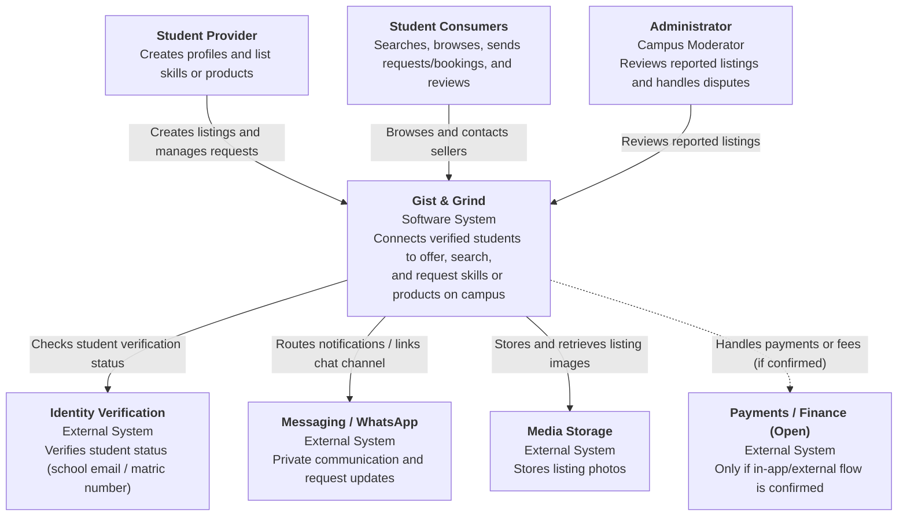
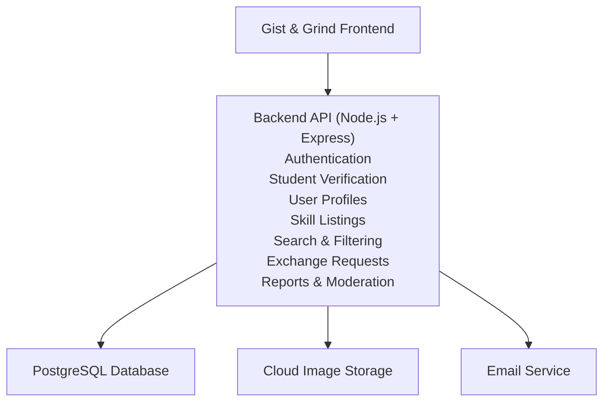

# GIST & GRIND'S - SYSTEM ARHITECTURE

## SYSTEM CONTEXT

Gist & Grind connects verified students on campus—starting at Babcock University—so providers can offer skills, products, 
or services while buyers can search, browse, and send exchange or booking requests, with administrators reviewing 
reported listings and external services handling identity verification, media storage, messaging/notifications, and (if later confirmed) payments.

## CONTAINER VIEW

The container diagram shows the different parts of Gist & Grind and how they connect with each other. The frontend is where students access and use the platform. The backend handles the main activities, such as registering students, verifying accounts, creating listings and searching for services. PostgreSQL is used to store the information on the platform, while the external services help with storing images and sending emails.

## ADR-001: Use a Modular Monolith for Gist & Grind MVP

**Status:** Accepted

### Context

A five-person development team is building an MVP with evolving requirements and five main features: Authentication(Register and log in, verify student identity), Profiles, Listing & Search, Requests/Bookings, and Reports/Moderation. 

### Decision
We will build Gist and Grind as a single Node.js and Express backend, organized into clear, separated modules and backed by a single relational database.

### Alternatives

- **Plain monolith:** Fast to start, but risks tangled dependencies across listings, verification, requests, and future features as the codebase grows.
- **Microservices:** Offers independent deployment and scaling per service, but adds deployment, networking, and operational overhead that is too early for an MVP.

### Consequences

**Pros:** 
- Single deployment unit.
- Easier debugging and testing of the application.
- Clear module boundaries that can be extracted later if needed.

**Cons:**
- Requires discipline to keep module boundaries clear and distinct.
- The application scales as one unit initially.

### Review Trigger

Re-evaluate whether a specific module needs independent scaling or whether multiple teams begin releasing independently.

## ADR-002: Selection of PostgreSQL as the Database

**Status:** Accepted

### Context

Gist & Grind requires a database to store information about student accounts, user profiles, skills listing and exchanges request. Since these data are related to each other, we require a database that is capable to organize this information and make it easily accessible for students.

### Decision

We suggest using PostgreSQL as the primary database for Gist & Grind. The database should be hosted on a managed platform so that we do not have to manage the database ourselves.

### Alternatives Considered

- **MySQL:** Another relational database that is able to store and manage related data.
- **MongoDB:** A NoSQL database that stores data in a more flexible document form.
- **PostgreSQL:** A relational database that supports relationships between data, transactions and searching.

We selected PostgreSQL due to the nature of information that is stored by Gist & Grind.

### Consequences

**Advantages:**
- Provides an ability to organize student accounts, profiles and listings.
- Supports relationships between various data.
- Supports transactions that ensure the consistency of data.
- Provides search capabilities that can help students find listings.

**Disadvantages:**
- We will need to learn how to manage and maintain the database.

- We will be responsible for backups and database security, even when using managed hosting.

### Cost

Using a managed PostgreSQL service may involve hosting fees as the platform grows. We will need to compare free-tier limits and paid plans before choosing a provider. We also need to consider storage, backups and database usage.

### Review Trigger

We may need to review this decision if the number of users and listings grows beyond what our current database setup can handle, if search becomes too slow, or if hosting costs become too high.

## Build vs. Buy Decisions

| Features     | Decision | Reasons                                            |
|--------------|----------|---------------------------------------------------|
| Authentication| Buy      | It may become easier for users to have an account. |
| Verification | Build    | The verification process for students will be required. |
| Profiles     | Build    | They are the part of the platform, so we will build them. |
| Skills       | Build    | The students should be able to work with their listings. |
| Search and filter    | Build    | We would like the students to search for services by keywords, categories and prices. |
| Exchange requests | Build    | This is one of the core features of Gist & Grind, so we will build it. |
| Database     | Buy      | We will use the managed PostgreSQL instead of building our own database server. |
| Image storage| Buy      | An existing cloud storage service can help us keep listing images. |
| Hosting      | Buy      | Managed hosting will help us deploy and maintain the application. |
| Emails       | Buy      | Existing email service will help us send notifications to users. |
| Payment      | Postpone | We did not choose the payment method in the PRD yet. |

## Hosting Plan

We want to utilize a hosted service to deploy Gist & Grind to the web so that it will be accessible online. By this, we will simplify the process of deployment and decrease our workload of maintaining a server.

### Deployment Process

1. First, we are going to push our application code to our GitHub repository.
2. Our hosting will connect to our GitHub repository and build our application.
3. We will set up a PostgreSQL database, connect it to the backend, and use `DATABASE_URL` variable.
4. We will configure the necessary environment variables and secrets using the hosted service.
5. After deployment, our hosting will give us a live HTTPS link, which students will be able to access.

### Reasons Behind Our Decision to Go with a Managed Hosting Service

- It simplifies the process of deploying updates.
- It simplifies maintaining servers manually.
- It ensures using HTTPS for securing connections.
- Allows concentrating efforts on development of core functionality.

### Further Improvements

As Gist & Grind grows, we may need to upgrade our hosting plan or move to a different provider if the number of users increases, the cost becomes too high, or we need more control over the server.

We will also consider choosing a hosting region close to our users to improve performance.
