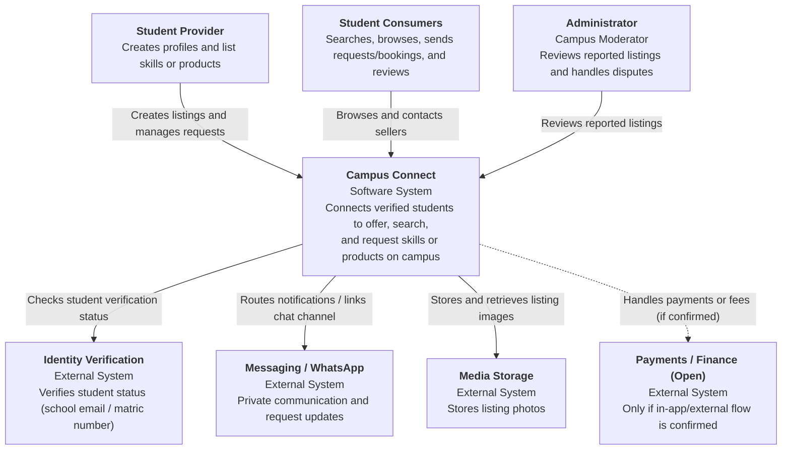

Gist & Grind connects verified students on campus—starting at Babcock University—so providers can offer skills, products, 
or services while buyers can search, browse, and send exchange or booking requests, with administrators reviewing 
reported listings and external services handling identity verification, media storage, messaging/notifications, and (if later confirmed) payments.
