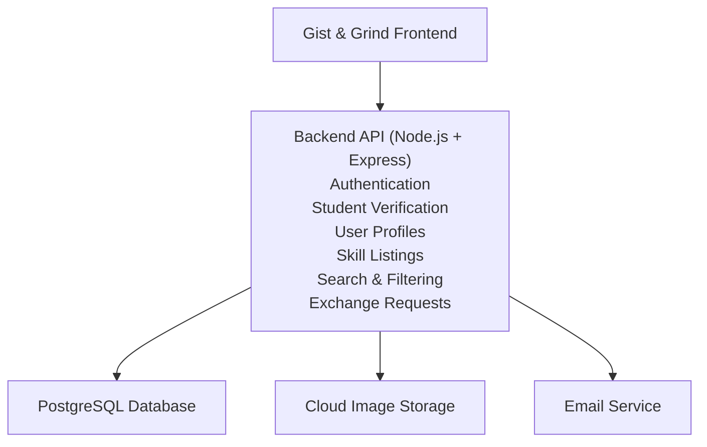

The container diagram shows the different parts of Gist & Grind and how they connect with each other. The frontend is where students access and use the platform. The backend handles the main activities, such as registering students, verifying accounts, creating listings and searching for services. PostgreSQL is used to store the information on the platform, while the external services help with storing images and sending emails.
